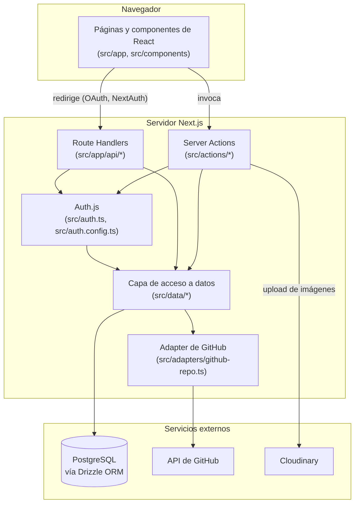
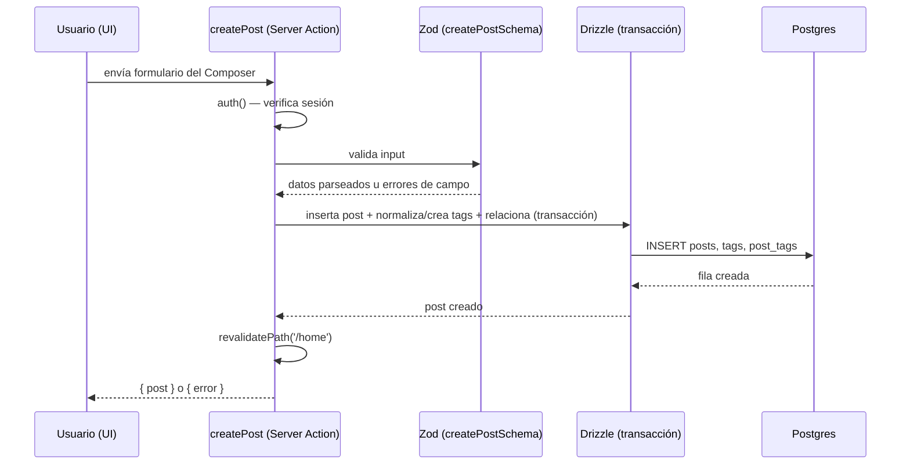

# Arquitectura

> Documentación técnica: pensada para quien necesita entender cómo está armado el sistema para poder modificarlo. Para el detalle de cada endpoint o server action, ver [`api.md`](./api.md). Para el "por qué" de decisiones puntuales, ver [design-patterns](./design-patterns/) y [design-principles](./design-principles/).

## Vista general

DevHub es una aplicación **Next.js (App Router)** monolítica: un único proyecto sirve tanto las páginas (React Server Components) como la capa de datos, sin un backend separado. La comunicación entre la UI y el servidor no pasa mayormente por una API REST propia, sino por **Server Actions** de Next.js (funciones `'use server'` invocadas directamente desde los componentes de cliente). Los únicos endpoints HTTP reales son los que exige un contrato externo: Auth.js y el flujo OAuth de GitHub.

## Capas

| Capa | Carpeta | Responsabilidad |
| --- | --- | --- |
| Presentación | `src/app/`, `src/components/` | Rutas (App Router), layouts y componentes de UI. Mayormente Server Components; los que necesitan interacción están marcados `'use client'`. |
| Server Actions | `src/actions/` | Punto de entrada mutable desde el cliente: valida con Zod, chequea sesión con `auth()`, escribe en la base y hace `revalidatePath` de lo que cambió. Es la "API" interna de la app (ver [`api.md`](./api.md)). |
| Route Handlers | `src/app/api/` | Los únicos endpoints HTTP reales, usados solo donde Server Actions no alcanza: el handler de NextAuth y el flujo OAuth manual para vincular una cuenta de GitHub ya logueada. |
| Acceso a datos | `src/data/` | Funciones de lectura (queries) reutilizables entre páginas y actions, un archivo por entidad (`post.ts`, `user.ts`, `tag.ts`, etc.). Centraliza las queries de Drizzle para no repetirlas. |
| Adapters / servicios | `src/adapters/`, `src/services/` | Traducción de APIs externas (GitHub) a modelos propios, y lógica de integración (OAuth, Cloudinary). |
| Dominio / esquema | `src/db/schema/` | Definición de tablas de Drizzle, una por entidad. Fuente de verdad del modelo de datos. |
| Validación | `src/schemas/` | Esquemas de Zod que definen el contrato de entrada de cada action (ver [`api.md`](./api.md)). |

## Modelo de datos (entidades principales)

Tablas definidas en `src/db/schema/` (ver también `drizzle/meta/0000_snapshot.json` para el esquema generado):

- `users`, `profiles` — cuenta y datos de perfil (bio, ubicación, avatar, portada).
- `accounts` — vínculos OAuth (GitHub), usados tanto para login como para "conectar GitHub" desde un perfil ya logueado por credenciales.
- `posts`, `post_tags`, `tags` — publicaciones y su relación muchos-a-muchos con tags.
- `post_likes`, `post_shares`, `bookmarks` — interacciones del usuario sobre un post (toggle).
- `comments`, `comment_likes` — comentarios, con soporte de respuesta anidada (`idParent`).
- `followers` — relación de seguimiento entre usuarios.
- `user_tag_follows` — relación de seguimiento entre un usuario y un tag.

## Flujo de ejemplo: crear un post

Para ilustrar cómo atraviesan las capas una operación concreta:

## Autenticación

Dos estrategias conviven detrás de la misma interfaz de Auth.js (documentado en detalle en [`design-patterns/behavioral/strategy.md`](./design-patterns/behavioral/strategy.md)): credenciales (email + `bcrypt`) y OAuth de GitHub. Además, un usuario que ya inició sesión por credenciales puede **conectar** su cuenta de GitHub después, sin volver a loguearse; ese flujo manual vive en `src/app/api/github/connect/` porque no es un login sino una vinculación de cuenta, y por eso no entra dentro de los providers de Auth.js.

## Decisiones de diseño

Las decisiones de arquitectura con más de una alternativa posible (por qué se eligió tal patrón, qué se descartó y qué costo se aceptó) están documentadas aparte para no mezclar "qué hay" con "por qué se eligió así":

- [`design-patterns/`](./design-patterns/) — patrones de diseño aplicados (Singleton, Builder, Adapter, Strategy).
- [`design-principles/`](./design-principles/) — aplicaciones puntuales de principios SOLID / Clean Code sobre código real del proyecto.
