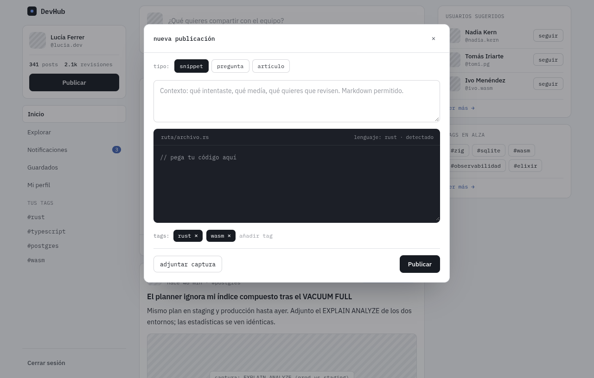
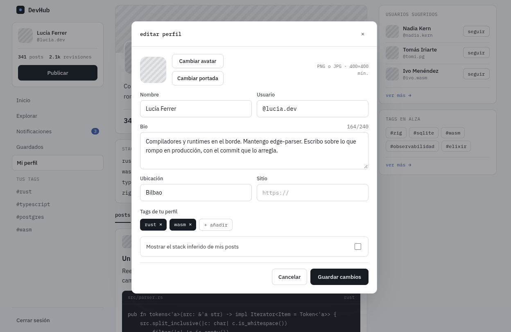

## Store global de modales (Singleton)

> Esta decisión está basada en el diseño concreto de la app: dos modales (nueva publicación y editar perfil) se disparan desde puntos distintos del árbol de componentes y no pueden coexistir abiertos al mismo tiempo.

**1 · Problema**
Varios componentes de la app necesitan abrir y cerrar modales sin estar relacionados entre sí por jerarquía de props. Manejar `isOpen` con `useState` local obligaría a levantar ese estado hasta un ancestro común y pasarlo por props a través de varios niveles, o duplicar el estado en distintos componentes, generando modales que se abren o cierran de forma inconsistente.

**2 · Alternativa**
Se consideraron:
- **Prop drilling / Context API de React**: pasar `isOpen` y los handlers manualmente o mediante un Context. Funciona, pero agrega boilerplate y acopla componentes intermedios a un estado que no les pertenece.
- **Estado local por componente**: cada modal maneja su propio `useState`. Simple al principio, pero no escala si varios lugares de la app necesitan abrir el mismo modal, y puede llevar a tener dos instancias del mismo modal abiertas a la vez.
- **Singleton con Zustand**: un único store accesible desde cualquier componente sin pasar por props ni por un Provider.

**3 · Decisión**
Se eligió el Singleton porque garantiza una única fuente de verdad para el estado de los modales en toda la aplicación. Cualquier componente que llame a `useModalStore` lee y escribe sobre la misma instancia, sin necesidad de Context ni de prop drilling, y sin riesgo de que existan dos estados de modal desincronizados. Además, se protegió explícitamente el patrón exponiendo solo el hook (`useModalStore`) y no el `create` interno, evitando que se pueda instanciar un segundo store por error.

**4 · Costo**
El principal trade-off es que se introduce un estado global compartido: cualquier parte del código puede modificarlo, lo que dificulta rastrear quién disparó un cambio si la app crece mucho. También acopla a la app a Zustand como dependencia externa. Para el alcance actual del proyecto, es un costo bajo, pero si se agregan muchos tipos de modal con lógica muy distinta entre sí, convendría evaluar separar el store o complementar con otro patrón (por ejemplo, un Factory para las configuraciones de cada modal).

## Código

El store ya está implementado (`src/store/modal-store.ts`). Los botones que lo consumen todavía están pendientes de integrar, el snippet de abajo muestra cómo se van a conectar una vez implementados.

```ts
import { create } from 'zustand';

type ModalType = 'create-post' | 'edit-profile';

interface ModalStore {
  closeModal: () => void;
  isOpen: boolean;
  openModal: (type: ModalType) => void;
  type: ModalType | null;
}

const useModalStoreInternal = create<ModalStore>((set) => ({
  closeModal: (): void => set({ isOpen: false, type: null }),
  isOpen: false,
  openModal: (type: ModalType): void => set({ isOpen: true, type }),
  type: null,
}));

export const useModalStore = useModalStoreInternal;
```

```tsx
// Botón "Publicar" del sidebar (pendiente de implementar)
function PublishButton() {
  const openModal = useModalStore((state) => state.openModal);
  return <Button type="button" variant="primary" onClick={() => openModal('create-post')}>Publicar</Button>;
}
```

```tsx
// Botón para editar perfil (pendiente de implementar)
function EditProfileButton() {
  const openModal = useModalStore((state) => state.openModal);
  return <Button type="button" variant="secondary" onClick={() => openModal('edit-profile')}>Editar perfil</Button>;
}
```

## Resultado

Modal de nueva publicación, abierto desde el botón Publicar del sidebar:



Modal de editar perfil, abierto desde Mi perfil:


